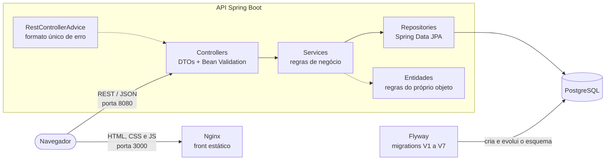
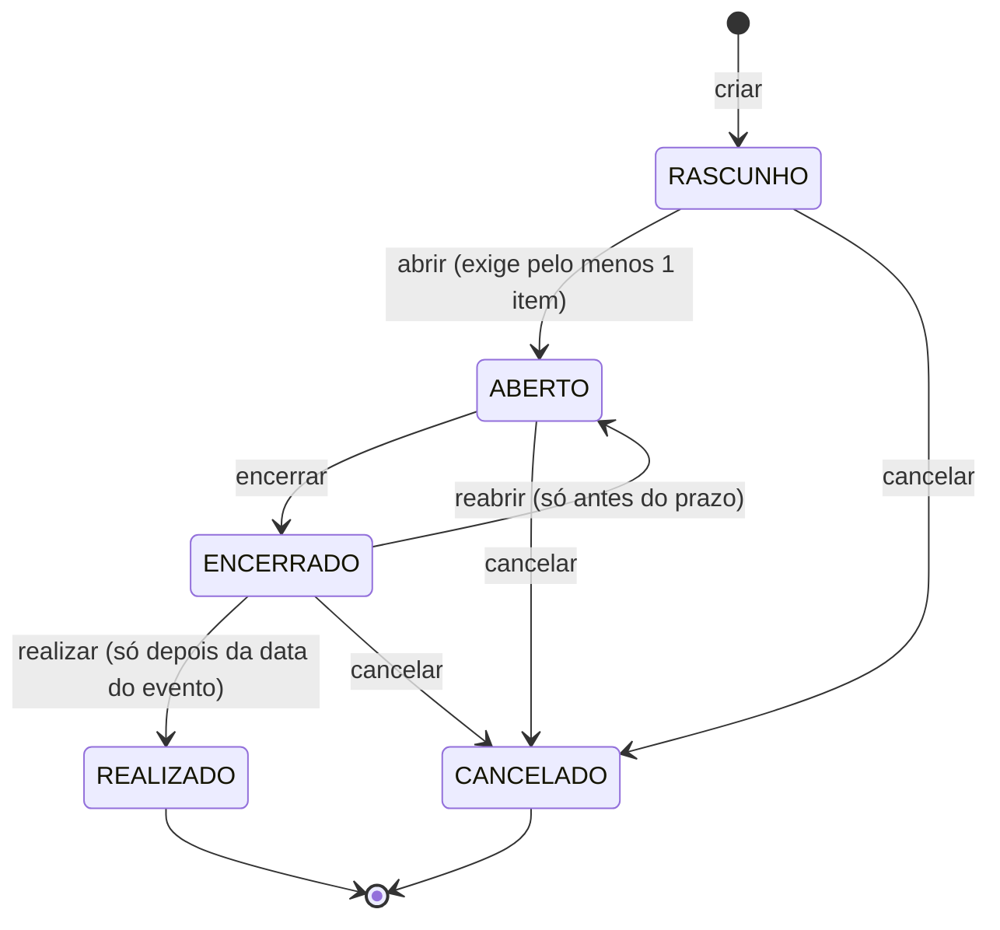

# Sulwork Eventos

Organizador de eventos de alimentação da equipe (café da manhã, almoço, lanche, confraternização). O organizador cria o evento, monta as categorias e os itens que precisam ser levados, e cada participante escolhe com o que vai contribuir. O sistema acompanha a cobertura (quanto do necessário já foi prometido), avisa sobre restrições alimentares e alérgenos e sugere a cada pessoa o que ela pode levar.

- Repositório: [thiago207/sulwork](https://github.com/thiago207/sulwork)
- Aplicação e Swagger públicos: publicação pendente. Os endereços locais e a configuração para publicação estão em [Como executar](#como-executar).

## Sumário

- [Arquitetura](#arquitetura)
- [Organização de pastas](#organização-de-pastas)
- [Tecnologias e versões](#tecnologias-e-versões)
- [Como executar](#como-executar)
- [Como executar os testes](#como-executar-os-testes)
- [API](#api)
- [Decisões e premissas](#decisões-e-premissas)
- [Ambiguidades do enunciado e como foram resolvidas](#ambiguidades-do-enunciado-e-como-foram-resolvidas)
- [Máquina de status](#máquina-de-status)
- [Cálculo da cobertura](#cálculo-da-cobertura)
- [Restrições e alérgenos](#restrições-e-alérgenos)
- [Feature livre: "O que eu posso levar?"](#feature-livre-o-que-eu-posso-levar)
- [Limitações conhecidas e melhorias futuras](#limitações-conhecidas-e-melhorias-futuras)
- [Uso de IA](#uso-de-ia)

## Arquitetura

Monorepo com três partes que sobem juntas pelo Docker Compose: banco PostgreSQL, API Spring Boot e front estático servido pelo Nginx. O navegador baixa o front do Nginx e conversa direto com a API (por isso a API libera CORS para a origem do front).



Camadas do back:

- **Controller**: recebe e devolve DTOs (records). Entidades nunca saem na API.
- **Service**: orquestra a regra (busca, valida, salva) e controla a transação.
- **Entidade**: guarda as regras que dependem só dela (ex.: `Evento.mudarStatus`, `Item.atualizar`, `Contribuicao.avisosDeAlergeno`), o que deixa essas regras testáveis sem banco.
- **Repository**: Spring Data JPA, com consultas JPQL e SQL nativo onde faz sentido (somas de cobertura, lock pessimista).
- **Erros**: exceções próprias (`NaoEncontradoException` 404, `ConflitoException` 409, `RegraNegocioException` 422) tratadas num único `@RestControllerAdvice` com o formato `timestamp, status, erro, mensagem, campos`.

Front: HTML, CSS e JavaScript puro em ES modules, sem framework. Cada tela é uma pasta com `.html` (estrutura e `<template>`), `.css` (visual) e `.js` (comportamento). O JS clona os templates e preenche os textos com `textContent`, que nunca interpreta HTML (proteção contra XSS sem precisar escapar string). A lógica pura (status, cobertura, validação, formatação) fica separada do DOM e é testada isoladamente.

## Organização de pastas

```
.
├── docker-compose.yml          banco + back + front
├── backend/                    API Spring Boot
│   ├── Dockerfile              build com Maven e imagem final só com o JRE
│   └── src/
│       ├── main/java/com/sulwork/backend/
│       │   ├── comum/          config (CORS, relógio, OpenAPI) e erro (exceções e advice)
│       │   ├── evento/         evento, status e transições
│       │   ├── participante/   participante, CPF e restrições alimentares
│       │   ├── participacao/   entrada e saída de participantes no evento
│       │   ├── categoria/      categorias e unidade de medida
│       │   ├── item/           itens e alérgenos
│       │   ├── contribuicao/   contribuições e somas (SQL nativo)
│       │   ├── cobertura/      cálculo de cobertura (Strategy)
│       │   ├── restricao/      resumo de restrições e alérgenos do evento
│       │   └── sugestao/       feature livre "o que eu posso levar"
│       ├── main/resources/
│       │   ├── application.properties
│       │   └── db/migration/   V1 a V7 (Flyway)
│       └── test/               unitários e integração (Testcontainers)
└── frontend/                   HTML + JS puro + Bootstrap
    ├── Dockerfile              build com Vite e Nginx servindo a pasta dist
    ├── nginx.conf
    ├── index.html              casca: menu, área de alertas e <main>
    ├── src/
    │   ├── main.js             importa estilos e inicia o roteador
    │   ├── roteador.js         rotas por hash (#/eventos/1/cobertura)
    │   ├── api.js              fetch + tratamento padrão de erro
    │   ├── dom.js              ajudantes para clonar e preencher templates
    │   ├── ui.js               alertas e erros de formulário
    │   ├── estilos/            tema, layout e componentes (CSS)
    │   ├── componentes/        alerta, barra, chips, pessoa, modal de confirmação
    │   ├── logica/             funções puras: status, cobertura, validação, rótulos
    │   └── paginas/            eventos/, detalhe/ (uma dupla html/js por aba), participantes/, sugestoes/
    └── tests/                  Vitest + jsdom
```

O pacote do back é organizado por domínio (package by feature): tudo de "item" fica em `item/`, e não espalhado em pastas `controller/`, `service/` e `repository/`. Assim, uma mudança de regra costuma mexer numa pasta só.

## Tecnologias e versões

| Parte | Tecnologia | Versão |
|---|---|---|
| Back | Java | 21 |
| | Spring Boot (Spring Framework 7) | 4.1.2 |
| | Spring Web MVC, Data JPA, Validation, Actuator | gerenciadas pelo Boot |
| | Hibernate ORM | 7.4.13 |
| | Jackson | 3.1.7 |
| | Flyway | 12.4.0 |
| | springdoc-openapi (Swagger UI) | 3.2.0 |
| | Lombok | gerenciado pelo Boot |
| | Maven (via Maven Wrapper `mvnw`) | |
| Banco | PostgreSQL | 18 (imagem `postgres:18-alpine`) |
| Testes do back | JUnit Jupiter | 5.14.2 no perfil de unitários e 6.0.3 na suíte completa |
| | Mockito | 5.23.0 |
| | Testcontainers (PostgreSQL) | 2.0.5 |
| Front | HTML + JavaScript (ES modules) | |
| | Bootstrap / Bootstrap Icons | 5.3 / 1.13 |
| | Vite | 8.3 |
| | Vitest + jsdom | 5.1 / 31.0 |
| Infra | Docker Compose, Nginx 1.29, Node 24 (só no build do front) | |

Diferenças do Spring Boot 4 em relação ao 3 que apareceram no projeto:

- **Starters modulares.** O projeto usa `spring-boot-starter-webmvc` e `spring-boot-starter-flyway`, e cada um tem o seu `*-test`.
- **Imports de teste novos.** O `@AutoConfigureMockMvc` mudou de pacote (`org.springframework.boot.webmvc.test.autoconfigure`).
- **Testcontainers 2.** A classe `PostgreSQLContainer` agora fica em `org.testcontainers.postgresql`.
- **springdoc 3.x.** A linha 2.x é a do Boot 3; o Boot 4 precisa da 3.x.
- **Jackson 3 (`tools.jackson`).**
  - Um primitivo ausente no JSON agora dá erro. Por isso os campos opcionais dos DTOs usam tipos wrapper (`Boolean`).
  - O projeto desliga `accept-float-as-int`, para que `2.5` num campo inteiro retorne 400 em vez de ser cortado.
- **Novo nome para o status 422.** O `HttpStatus.UNPROCESSABLE_ENTITY` passou a se chamar `UNPROCESSABLE_CONTENT`.
- **JUnit.** O perfil `unitarios-junit5` executa os testes unitários em JUnit 5, conforme o desafio. Os testes de integração usam JUnit 6 porque a extensão de testes da versão do Spring Framework usada pelo projeto exige essa API.

## Como executar

### Pré-requisitos

- **Docker** com Docker Compose. É o único requisito para rodar tudo.
- **Para desenvolver e rodar testes fora do Docker:**
  - JDK 21, para o back. O Maven vem pelo wrapper.
  - Node 24, para o front.
  - O Docker continua necessário: o PostgreSQL só roda em container, e os testes de integração usam Testcontainers.

### Tudo pelo Docker

Na raiz do projeto:

```bash
docker compose up -d --build
```

| Serviço | Endereço |
|---|---|
| Front | http://localhost:3000 |
| API | http://localhost:8080/api |
| Swagger UI | http://localhost:8080/swagger-ui.html |
| Saúde da API | http://localhost:8080/actuator/health |
| PostgreSQL | `localhost:5432`, banco, usuário e senha `sulwork` |

O backend só sobe depois que o banco responde (healthcheck), e o Flyway cria o esquema na primeira subida. Usuário, senha e nome do banco podem ser trocados pelas variáveis `DB_NOME`, `DB_USUARIO` e `DB_SENHA`.

```bash
docker compose ps                 # status dos containers
docker compose logs -f backend    # logs da API
docker compose down               # para tudo (os dados ficam no volume dados_banco)
```

### Em modo desenvolvimento

```bash
docker compose up -d banco        # só o banco

cd backend
./mvnw spring-boot:run            # API em http://localhost:8080

cd frontend
npm install
npm run dev                       # front em http://localhost:5173, recarrega ao salvar
```

O front em desenvolvimento lê a URL da API de `frontend/.env.development` (`VITE_API_URL`). No build do Docker essa URL é passada como argumento e gravada no JavaScript gerado.

### Configuração para publicação

- Defina `VITE_API_URL` com a URL pública do backend, sem o sufixo `/api`, antes de gerar a imagem do frontend.
- Defina `CORS_ORIGENS` no backend com a origem pública do frontend, incluindo o protocolo e sem barra final.
- Configure `DB_URL`, `DB_USUARIO` e `DB_SENHA` para o PostgreSQL do ambiente quando o backend for executado fora do Compose.
- Valide o frontend e as rotas `/actuator/health`, `/swagger-ui.html` e `/v3/api-docs` na URL pública do backend. Use dados fictícios na demonstração pública.

## Como executar os testes

**Back** (precisa do Docker rodando, porque os testes de integração sobem um PostgreSQL descartável com Testcontainers):

```bash
cd backend
./mvnw test
./mvnw -Punitarios-junit5 test
```

O primeiro comando roda a suíte completa. O segundo roda os unitários com JUnit 5. No Windows, substitua `./mvnw` por `.\mvnw.cmd`.

- **Unitários:** regras das entidades, services com Mockito, CPF, transições de status, cobertura, alérgenos e sugestões.
- **Integração:** endpoints principais com `@SpringBootTest` + MockMvc + PostgreSQL real. Cobre o limite de contribuições concorrentes, a saída e o encerramento durante gravações, o prazo durante a espera por lock, a duplicidade de categorias e a exclusão de participantes.

**Front:**

```bash
cd frontend
npm install
npm test
```

Os testes usam Vitest + jsdom:

- formatação de cobertura;
- regras de status e confirmação;
- validação de formulários;
- máscara de CPF;
- templates e alertas;
- telas e formulários renderizados com a API simulada (`vi.mock`): lista de eventos, sugestões e edição de contribuições, itens e categorias;
- decisões de prazo e status em diferentes fusos.

> No Windows, rode o `npm test` com o caminho começando em `C:` maiúsculo (ex.: `cd C:\projeto\frontend`). Se o terminal estiver em `c:\` minúsculo, o Node carrega o Vitest duas vezes e os testes falham com `Cannot read properties of undefined (reading 'config')`.

## API

Todas as rotas começam com `/api`. A documentação completa, com exemplos e respostas de erro, está no Swagger.

| Recurso | Rotas |
|---|---|
| Eventos | `GET/POST /eventos`, `GET/PUT/DELETE /eventos/{id}`, `PATCH /eventos/{id}/status` |
| Participantes | `GET/POST /participantes`, `GET/PUT/DELETE /participantes/{id}` |
| Participação | `GET /eventos/{id}/participantes`, `POST/DELETE /eventos/{id}/participantes/{participanteId}` |
| Categorias | `GET/POST /eventos/{id}/categorias`, `GET/PUT/DELETE /eventos/{id}/categorias/{categoriaId}` |
| Itens | `GET/POST /eventos/{id}/itens`, `GET/PUT/DELETE /eventos/{id}/itens/{itemId}` |
| Contribuições | `GET/POST /eventos/{id}/contribuicoes`, `PUT/DELETE /eventos/{id}/contribuicoes/{contribuicaoId}`, `GET /participantes/{id}/contribuicoes` |
| Cobertura | `GET /eventos/{id}/cobertura` |
| Restrições | `GET /eventos/{id}/restricoes` |
| Sugestões | `GET /eventos/{id}/participantes/{participanteId}/sugestoes` |

Códigos de erro: **400** validação (com a lista de `campos`), **404** não encontrado, **409** conflito de duplicidade, **422** regra de negócio.

## Decisões e premissas

### Domínio

- **Evento**: nome, descrição, tipo (`CAFE_DA_MANHA`, `ALMOCO`, `LANCHE`, `CONFRATERNIZACAO`, `OUTRO`), data e hora, prazo para alterações e status.
- **Participante**: nome, CPF, restrições alimentares (conjunto de enum), observação livre e flag `ativo`.
  - O CPF é único, tem 11 dígitos e precisa ter dígitos verificadores válidos.
  - Ele é salvo só com números, mas a API devolve o CPF mascarado.
- **Participação**: liga evento e participante. É única por par (evento, participante) e tem flag `ativo`.
- **Categoria**: nome, meta (inteiro) e unidade (`UNIDADE`, `LITRO`, `KG`, `PACOTE`, `GARRAFA`).
- **Item**: nome, categoria, quantidade necessária, se é obrigatório e alérgenos. Não tem unidade própria: herda a da categoria.
- **Contribuição**: participação + item + quantidade, com flag `ativo`.

### Regras e o porquê de cada uma

1. **Status em sequência: RASCUNHO, ABERTO, ENCERRADO, REALIZADO.**
   - Encerrado pode voltar para aberto, mas só se o prazo ainda não venceu.
   - Cancelado pode vir de rascunho, aberto ou encerrado.
   - Realizado e cancelado são finais. Transição inválida retorna 422.
   - *Por quê:* o evento tem um ciclo de vida claro. Reabrir depois do prazo permitiria mudanças que os participantes já não esperam, e estados finais garantem que o histórico de um evento que aconteceu (ou foi cancelado) não muda mais.

2. **Prazo e status juntos.** Entrar, sair, incluir, alterar ou remover contribuição só é permitido com o evento ABERTO e antes do prazo. Nada muda de status sozinho: o organizador encerra manualmente.
   - *Por quê:* o prazo existe para dar ao organizador uma lista estável antes de comprar o que faltar.
   - Encerrar automaticamente exigiria um agendador e tiraria do organizador a decisão de dar mais tempo. Por isso o prazo vencido só bloqueia as alterações, sem mudar o status.

3. **O que cada status permite editar.**
   - Em RASCUNHO, só o evento, as categorias e os itens; participantes e contribuições entram a partir de ABERTO.
   - O evento pode ser editado em RASCUNHO e ABERTO. Em ENCERRADO, REALIZADO e CANCELADO não.
   - *Por quê:* o rascunho é a fase de montar a lista. Com o evento aberto ainda é preciso corrigir a descrição ou estender o prazo, mas depois de encerrado os dados viram registro.

4. **Datas.**
   - O prazo é sempre antes da data do evento.
   - Ao criar, as duas datas precisam estar no futuro.
   - Ao editar, a exigência de "no futuro" vale só para a data que foi alterada.
   - *Por quê:* sem a última regra, não daria para corrigir a descrição de um evento aberto cujo prazo já venceu, porque a data antiga reprovaria a validação.

5. **Participação única por evento.**
   - Ninguém entra duas vezes no mesmo evento (409).
   - Sair desativa a participação e as contribuições daquela pessoa. É exclusão lógica: o registro continua no banco.
   - Se a pessoa voltar, a participação antiga é reativada, mas as contribuições continuam inativas.
   - *Por quê:* reativar a mesma linha preserva a restrição de unicidade do banco e o histórico. As contribuições não voltam sozinhas porque a cobertura pode ter mudado enquanto a pessoa estava fora: ela escolhe de novo.

6. **Excluir participante é exclusão lógica (`ativo = false`).**
   - A exclusão é bloqueada (422) se a pessoa tem participação ativa em evento ABERTO ou ENCERRADO; ela precisa sair do evento antes.
   - Quando permitida, a exclusão desativa também as participações e contribuições da pessoa. Os registros ficam no banco, mas deixam de aparecer nas listas e na cobertura, inclusive em eventos realizados e cancelados.
   - Cadastrar de novo com o CPF de um excluído reativa o cadastro com os dados novos. Os vínculos e contribuições anteriores permanecem inativos.
   - *Por quê:* apagar a pessoa deixaria contribuições "órfãs" contando na cobertura de um evento em andamento. Obrigar a saída antes passa pelo fluxo normal, que respeita o prazo (regra 2).
   - Como o CPF é único também entre inativos, sem a reativação a pessoa ficaria bloqueada para sempre.

7. **A soma das contribuições ativas de um item não passa da quantidade necessária.**
   - As escritas vinculadas a um evento começam pelo lock da linha do evento. A operação que obtém o lock primeiro prevalece e a seguinte reavalia o status e o prazo depois de esperar. Isso também evita que uma contribuição seja gravada depois que a participação foi desativada.
   - Ao criar ou alterar uma contribuição, a aplicação trava também o item antes de somar, e confere novamente o prazo antes de gravar.

8. **A quantidade necessária não pode ser reduzida para menos do que já foi contribuído.**
   - *Por quê:* senão a regra 7 seria quebrada "por trás", e itens apareceriam com mais de 100%.

9. **Progresso da categoria = soma do que foi contribuído nos itens dela, na unidade da categoria, comparada à meta cadastrada.**
   - *Por quê:* a categoria agrupa itens da mesma unidade (litros de bebida, unidades de salgado), então somar faz sentido.
   - O item herda a unidade da categoria justamente para que essa soma nunca misture litros com quilos.
   - A tela avisa quando os itens pedem menos do que a meta, porque nesse caso a categoria nunca chega a 100%.

10. **Cobertura, implementada com o padrão Strategy (interface `CalculoCobertura`).** Ver [Cálculo da cobertura](#cálculo-da-cobertura).
    - *Por quê:* a fórmula é a parte mais provável de mudar (outros pesos, outro critério). Com a Strategy, dá para trocar o cálculo sem mexer no service.
    - As somas vêm de SQL nativo agrupado por item e categoria, e contribuições e participações inativas nunca entram nelas.

11. **Alérgenos.** Cada restrição alimentar declara os alérgenos com que conflita. Ver [Restrições e alérgenos](#restrições-e-alérgenos).

12. **Feature livre "O que eu posso levar?".** Ver [a seção da feature](#feature-livre-o-que-eu-posso-levar).

### Outras premissas

- **Quantidades são inteiras** (meta, quantidade necessária, contribuição). Valor com decimal retorna 400 ("Informe um número inteiro."), nunca é truncado.
  - *Por quê:* a meta da categoria foi definida como inteiro no enunciado; para meio litro, a unidade certa é outra (ex.: garrafa de 500 ml).
- **Nome de categoria é único no evento**, sem diferenciar maiúscula, minúscula e acento (409).
  - *Por quê:* "Refrigerante" e "refrigerante" no mesmo evento dividiriam as contribuições sem motivo.
- **O evento só abre com pelo menos um item.**
  - *Por quê:* um evento aberto sem itens não deixa ninguém contribuir.
- **"Realizado" só depois da data do evento**, e toda mudança de status pede confirmação na tela.
  - *Por quê:* realizado é final, e marcar por engano antes da data não teria volta.
- **Fuso America/Recife.**
  - As datas são `LocalDateTime` comparadas com um `Clock` configurado nesse fuso.
  - A interface exibe e compara os horários de Recife mesmo quando o navegador está em outro fuso.
  - Nos testes, o `Clock` é fixo, o que deixa as regras de prazo determinísticas.
- **Exclusão lógica em participante, participação e contribuição.**
  - *Por quê:* preserva o histórico e as restrições de unicidade.
  - Categorias e itens são excluídos de verdade, porque só podem ser removidos enquanto o evento é editável e sem dependências.
- **LGPD.** A API nunca devolve o CPF completo (`***.666.384-**`). Na edição, o CPF é opcional: vazio mantém o atual.
- **Mensagens para o usuário em português, com rótulos amigáveis.** A tela mostra "vegano", e não `VEGANO`; "Quantidade necessária", e não `quantidadeNecessaria`.

## Ambiguidades do enunciado e como foram resolvidas

| Ambiguidade | Decisão |
|---|---|
| O evento pode ser editado depois de aberto? | Sim, em RASCUNHO e ABERTO. Depois de encerrado vira registro (regra 3). |
| "Datas no futuro" vale também na edição? | Só para a data que mudou. Assim dá para editar a descrição de um evento com prazo vencido e também estender o prazo (regra 4). |
| O status muda sozinho quando o prazo vence? | Não. O prazo bloqueia alterações; o organizador encerra manualmente (regra 2). |
| Qual a unidade do item? | A da categoria. Isso mantém a soma da meta coerente (regra 9). |
| O que acontece com as contribuições de quem sai do evento? | Ficam inativas e saem das somas. Se a pessoa voltar, a participação é reativada, mas as contribuições não (regra 5). |
| E com as de quem é excluído do sistema? | A exclusão é bloqueada enquanto a pessoa está em evento em andamento; ela sai antes, pelo fluxo normal (regra 6). Dados antigos nessa situação foram corrigidos pela migration V6. |
| O CPF de um participante excluído pode ser reutilizado? | Pode, e o cadastro antigo é reativado com os dados novos (regra 6). |
| Quantidades podem ter casas decimais? | Não. São inteiras e valor decimal retorna 400. |
| Na feature livre, "excluir itens que conflitam com as restrições de qualquer participante ativo" e ao mesmo tempo "marcar os que conflitam só com alguns" se contradizem: se qualquer conflito exclui, não sobra nada para marcar. | Um item é excluído quando conflita com **todos** os participantes que têm restrição; quando conflita só com **alguns**, aparece marcado com quantas pessoas e quais restrições ele afeta. |
| Como medir "cobertura geral"? | Média ponderada pela cobertura de cada item, obrigatório com peso 2 e opcional com peso 1, mais o indicador "obrigatórios completos X de Y". |

## Máquina de status



- **Onde as transições ficam:** no próprio enum `StatusEvento`, num `Map` de status para os destinos permitidos.
- **Regras que dependem de dados:** prazo, data do evento e existência de itens são conferidos em `Evento.mudarStatus` e `EventoService.mudarStatus`.
- **Como o front sabe o que mostrar:** a API devolve `proximosStatus` em cada evento, e o front exibe só os botões das transições possíveis naquele momento.

## Cálculo da cobertura

- **Por item:** `min(contribuído, necessário) / necessário`.
- **Geral:** média ponderada das coberturas dos itens, com peso 2 para obrigatórios e peso 1 para opcionais.
- **Indicador:** "obrigatórios completos X de Y".
- **Por categoria:** `contribuído / meta`, limitado a 100%.
- **O que entra nas somas:** só contribuições ativas de participações ativas.

**Exemplo numérico** (é o cenário do `CoberturaIntegracaoTest`, que roda contra PostgreSQL real):

| Categoria (meta) | Item | Obrigatório | Necessário | Contribuído | Cobertura do item |
|---|---|---|---|---|---|
| Padaria (25 unidades) | Pão | sim | 20 | 15 | 15 / 20 = 75% |
| Padaria | Bolo | não | 2 | 0 * | 0% |
| Bebidas (6 litros) | Café | sim | 3 | 3 | 100% |
| Bebidas | Suco | não | 4 | 1 * | 25% |
| Talheres (10 unidades) | (sem itens) | | | | |

\* O Bolo tinha 2 unidades de alguém que saiu do evento, e o Suco tinha mais 2 litros numa contribuição removida. Por serem inativas, não contam.

- **Geral:** (75 × 2 + 0 × 1 + 100 × 2 + 25 × 1) / (2 + 1 + 2 + 1) = 375 / 6 = **62,5%**
- **Obrigatórios completos:** só o Café, portanto **1 de 2**.
- **Por categoria:**
  - Bebidas: 4 / 6 = **66,7%**
  - Padaria: 15 / 25 = **60%**
  - Talheres: 0 / 10 = **0%**

## Restrições e alérgenos

Cada `RestricaoAlimentar` declara no próprio enum os `Alergeno`s com que conflita:

| Restrição | Conflita com |
|---|---|
| Vegano | lactose, ovo, carne, peixe, frutos do mar, mel |
| Vegetariano | carne, peixe, frutos do mar |
| Sem glúten | glúten |
| Sem lactose | lactose |
| Sem mel | mel |
| Alergia a amendoim | amendoim |
| Alergia a frutos do mar | frutos do mar |
| Alergia a ovo | ovo |
| Alergia a peixe | peixe |

Um item conflita com uma pessoa quando algum alérgeno dele está no conjunto de alguma restrição dela. Com essa regra única, o sistema mostra:

- **Resumo do evento:** quantos participantes ativos têm cada restrição, e as observações livres que eles deixaram (ex.: "alergia grave, evitar traços").
- **Por item:** quantos participantes são afetados e por quais restrições. As linhas afetadas ficam destacadas.
- **Ao contribuir:** se o item conflita com a restrição de quem está levando, a contribuição é aceita e volta com um aviso em destaque (ex.: "O item Coxinha contém carne, que conflita com sua restrição: vegano.").
  - *Por quê não bloquear:* a pessoa pode estar levando para os outros; quem decide é ela.

**Por que o mapeamento fica no enum:** a regra fica num lugar só, é testável sem banco e uma restrição nova é uma linha no enum (mais o CHECK no banco, como a migration V6 fez com "Alergia a peixe" e "Sem mel").

## Feature livre: "O que eu posso levar?"

**Problema.** Com muitos itens, a pessoa abre o evento e não sabe por onde começar. Ela acaba levando o que é fácil (que geralmente já está coberto) e o obrigatório fica faltando, ou leva algo que metade do time não pode comer.

**Funcionamento.** A pessoa escolhe o próprio nome e recebe uma lista de cards com o que ainda falta:

1. Só entram itens com quantidade pendente.
2. Itens que conflitam com **todos** os participantes que têm restrição são escondidos. O total escondido aparece numa nota.
3. Itens que conflitam só com **alguns** aparecem marcados com quantas pessoas e quais restrições afetam. A marcação fica vermelha quando o conflito é com a própria pessoa.
4. Ordem: obrigatórios primeiro, depois a menor cobertura, depois o maior faltante e por fim o nome em ordem alfabética do português (`Collator` pt-BR, para "Água" vir antes de "Leite").
5. Cada card tem o botão **Vou levar**, com a quantidade já preenchida com o que falta. A contribuição é criada ali mesmo, sem voltar para a aba de contribuições.

**Decisões.**

- **Função pura.** A montagem da lista (`Sugestoes.montar`) recebe os dados prontos e devolve a lista. Os testes de filtro e ordenação rodam sem Spring e sem banco, e o service só busca os dados e chama a função.
- **"Todos com restrição" como critério para esconder.** Esse é o ponto de equilíbrio da ambiguidade descrita acima: só some o que ninguém com restrição pode comer, e o resto fica visível com o aviso.
- **422 quando não faz sentido.** O endpoint responde 422 se o participante não está ativo naquele evento, porque sugerir itens a quem não participa não tem uso.

## Limitações conhecidas e melhorias futuras

- **Sem autenticação.**
  - Qualquer pessoa com acesso à tela pode escolher outro nome em "Quem é você?" e agir como outro participante.
  - O próximo passo seria login (por exemplo OAuth2 com o provedor da empresa) e a separação entre organizador e participante.
- **Caso de borda na feature livre:** se só uma pessoa do evento tem restrição, qualquer item que conflite com ela some da sugestão de todos.
  - A pessoa ainda vê o item na aba de itens, e a nota de "itens ocultos" avisa.
  - Uma melhoria seria esconder só para quem tem o conflito e marcar para os demais.
- **Quantidades só inteiras.** Para frações, seria preciso trocar os tipos para decimal no banco, nos DTOs e no cálculo.
- **Sem paginação** nas listas de eventos e participantes. Funciona bem para uma equipe, mas não para uma empresa inteira.
- **Nada é automático.**
  - O encerramento é manual (decisão da regra 2). Um lembrete automático ao organizador quando o prazo vencer seria útil.
  - Também não há notificação por e-mail ou chat quando falta pouco para o prazo.
- **Teste de interface.** A suíte renderiza telas e formulários com a API simulada. Testes de ponta a ponta no navegador complementariam essa cobertura.

## Uso de IA

- **Ferramenta usada nesta revisão:** Codex.
- **Etapas em que ajudou:** análise do código, reprodução de falhas com testes, implementação das correções e verificação das suítes.
- **Sugestão incorporada:** ordenar as alterações concorrentes com um lock por evento, para que mudanças de status, participações e contribuições observem a mesma ordem.
- **Sugestão ajustada:** a tentativa de usar JUnit 5 na suíte inteira foi descartada após erro na extensão do Spring. O JUnit 5 ficou no perfil de unitários, enquanto a integração manteve JUnit 6.
- **Decisão que exigiu julgamento:** seguir a política da migration V6 e conservar os registros históricos no banco, retirando da cobertura e das listagens os vínculos desativados ao excluir um participante.

Este relato cobre a revisão registrada. O candidato pode complementá-lo com o uso de IA nas etapas anteriores do projeto e com seu próprio relato sobre as decisões.
